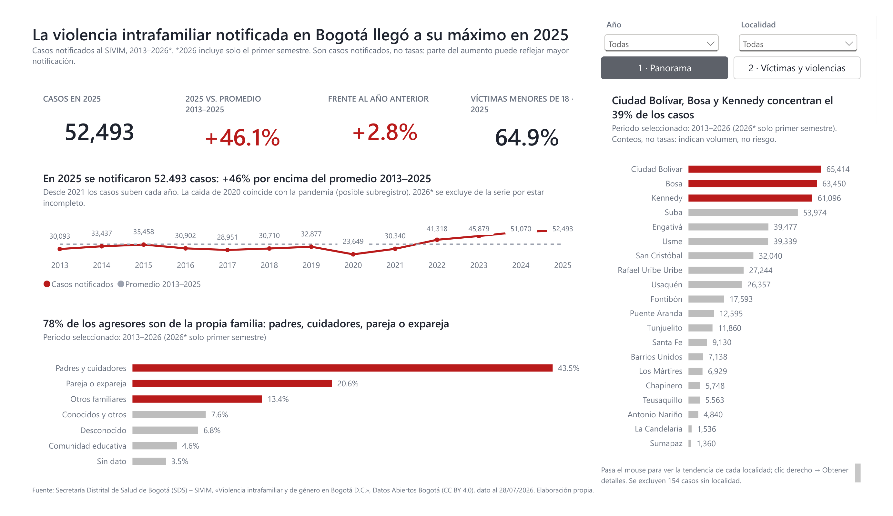

# Domestic and gender-based violence in Bogotá — Power BI dashboard

[Versión en español](README.md)

A corporate-style Power BI dashboard that covers the full self-service BI cycle: data cleaning in Power Query (M), a star-schema model, 54 explicit DAX measures, and a design grounded in visual perception and data storytelling. The report itself is in Spanish.

> **Big Idea:** in 2025, Bogotá recorded 52,493 reported cases of domestic violence, the highest figure in the series and 46% above the 2013–2025 average. The violence happens at home, is committed by family members, and falls mostly on children and women.

## What's in the repo

- `powerbi/VIF_Bogota_Dashboard.pbix`: ready to open, with the data already loaded.
- `powerbi/VIF_Bogota_Dashboard.pbip`: the same project as text files (TMDL model and PBIR report), so the measures, relationships and visuals can be read and version-controlled.
- `docs/`: the justification paper (4 pages, APA 7, in Spanish), the ETL steps, the DAX measures and the storytelling review.
- `herramientas/`: Python scripts used to generate and validate the report files and to build the PDF.
- `datos/README.md`: how to download the source CSV.

## How to open it

- **To explore it:** open the `.pbix` in Power BI Desktop.
- **To reproduce the ETL:** download the CSV (see `datos/README.md`), open the `.pbip`, set the `pRutaCSV` parameter to the file's location and refresh.

## How it's built

1. **ETL (Power Query).** Each row is a reported case: 492,837 cases from 2013 to 2026. Two staging queries with load disabled do all the reading and cleaning, and two parameters make the process reproducible. We fixed real errors (mislabeled age groups, inconsistent columns, misassigned districts) and kept uncomfortable but real data: identical rows, which are different victims with no ID, and missing values shown as a category.
2. **Star schema.**
   - One case can involve several types of violence, so there are two fact tables: one row per victim, and one row per victim and violence type.
   - Both share eight conformed dimensions through 18 one-to-many, single-direction relationships.
   - Implicit measures are disabled.
3. **DAX.** All 54 measures are explicit: reference-year KPIs with `REMOVEFILTERS`, the gap against the historical average with `AVERAGEX` over `ALL(Dim_Anio)`, `RANKX` with `ALLSELECTED`, `DIVIDE` everywhere, and dynamic titles that stay true under any filter. Validation caught a context bug: `ALL(column)` did not remove the filter on its sort-by column. We fixed it with `ALL(table)`.
4. **Design.**
   - Grey plus a single red accent as a pre-attentive cue.
   - High data-ink ratio.
   - A straight (not smoothed) line for the yearly series and sorted bars starting at zero.
   - An age-sex pyramid.
   - Cross-filtering between visuals.
   - A report-page tooltip and a drill-through page by district.
   - A call to action with an owner and a deadline for each priority.

## Stated limitations

These are **reported cases, not rates**. Without population by district there is no incidence, and part of the increase may reflect more reporting. The 2020 drop matches the pandemic (likely under-reporting). The source has no month or semester, so 2026 (first half) is not compared in volume with full years. District counts show workload, not risk.

## Team

Adrian Felipe Grateron Ramirez, Jhonatan Smith Doncel and Jorge Emmanuel Marin. Final project for the Data Visualization course, MSc in Data Science, Universidad Santo Tomás (2026).

## License

The code, Power BI project and documentation are released under the [MIT License](LICENSE). The source data is **not** covered by it: it belongs to Bogotá's Health Department and is published under CC BY 4.0 (see below).

## Data source

Secretaría Distrital de Salud de Bogotá (SDS), SIVIM. *Violencia intrafamiliar y de género en Bogotá D.C.* [Dataset], Datos Abiertos Bogotá, [CC BY 4.0](https://creativecommons.org/licenses/by/4.0/). <https://datosabiertos.bogota.gov.co/dataset/numero-de-casos-de-violencia-intrafamiliar>
