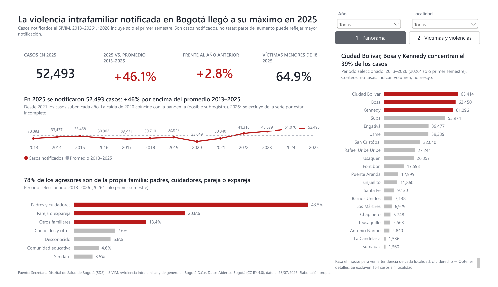
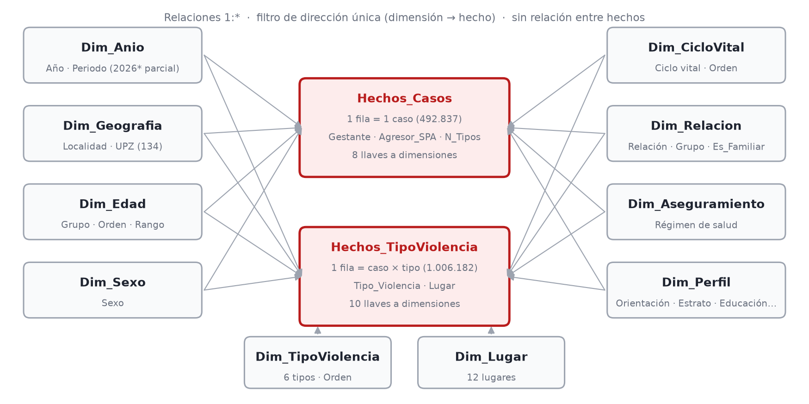
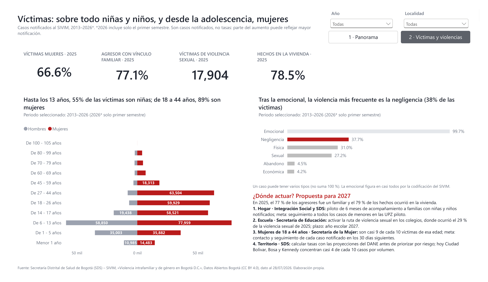

# Violencia intrafamiliar y de género en Bogotá — dashboard en Power BI

[English version](README.en.md)

Dashboard corporativo en Power BI con el ciclo completo de BI de autoservicio: depuración en Power Query (M), modelo en estrella, 54 medidas explícitas en DAX y un diseño basado en percepción visual y storytelling.



> **Gran Idea:** en 2025 se notificaron 52.493 casos de violencia intrafamiliar en Bogotá, la cifra más alta de la serie y un 46 % más que el promedio 2013–2025. La violencia ocurre en casa, la ejerce la propia familia y recae sobre todo en niñas, niños y mujeres.

## Qué hay en el repositorio

```
powerbi/
├── VIF_Bogota_Dashboard.pbix              ← listo para abrir (incluye los datos cargados)
├── VIF_Bogota_Dashboard.pbip              ← proyecto en texto (TMDL + PBIR), legible y versionable
├── VIF_Bogota_Dashboard.SemanticModel/    ← modelo: tablas, relaciones y medidas DAX en TMDL
└── VIF_Bogota_Dashboard.Report/           ← páginas y visuales en JSON (PBIR)
docs/
├── Justificacion_Dashboard_VIF_APA7.pdf   ← documento de justificación (4 páginas, APA 7)
├── ETL_Power_Query.md                     ← consultas M y las 13 decisiones de limpieza
├── DAX_Medidas.md                         ← medidas, lógica y cifras de control
├── Validacion_Storytelling.md             ← revisión de la historia y del diseño
└── img/                                   ← capturas del tablero y diagrama del modelo
herramientas/                              ← scripts en Python usados para generar visuales, validar y documentar
tema/Tema_VIF_Bogota.json                  ← tema de Power BI (gris + un acento)
datos/README.md                            ← cómo descargar el CSV de origen
```

## Cómo abrirlo

- **Para verlo:** abre `powerbi/VIF_Bogota_Dashboard.pbix` en Power BI Desktop. Los datos ya vienen cargados.
- **Para reproducir el ETL:** descarga el CSV como se explica en [`datos/README.md`](datos/README.md), abre el `.pbip` y cambia el parámetro `pRutaCSV` (*Transformar datos → Administrar parámetros*) por la ruta donde guardaste el archivo. Después, *Actualizar*.

## Cómo está construido

**1. ETL en Power Query.** Cada fila del archivo es un caso notificado (492.837 casos de 2013 a 2026). Dos consultas de apoyo con la carga deshabilitada (`VIF_Origen` y `VIF_Limpia`) concentran la lectura y la depuración, y dos parámetros hacen el proceso reproducible. La regla fue corregir el error y conservar el dato incómodo pero real: se corrigieron etiquetas mal escritas, incoherencias entre columnas y UPZ mal asignadas, y se conservaron las filas idénticas (son víctimas distintas sin identificador) y los «Sin dato». El detalle está en [`docs/ETL_Power_Query.md`](docs/ETL_Power_Query.md).

**2. Modelo en estrella.** Un caso puede sufrir varios tipos de violencia, así que hay dos tablas de hechos: `Hechos_Casos` (una fila por víctima) y `Hechos_TipoViolencia` (una fila por caso y tipo). Comparten ocho dimensiones y se conectan con 18 relaciones uno a muchos con filtro en una sola dirección. No hay relaciones bidireccionales y las medidas implícitas están desactivadas.



**3. DAX.** Son 54 medidas explícitas, sin columnas calculadas para agregar. Destacan:
- KPI del año de referencia con `REMOVEFILTERS`.
- Variación frente al promedio con `AVERAGEX` sobre `ALL(Dim_Anio)`.
- Ranking con `RANKX` y `ALLSELECTED`.
- `DIVIDE` en toda división.
- Títulos dinámicos que siguen siendo ciertos con cualquier filtro.

Al validar encontramos un error de contexto: `ALL(columna)` no quitaba el filtro de la columna de orden. Lo corregimos con `ALL(tabla)`. Todo está documentado en [`docs/DAX_Medidas.md`](docs/DAX_Medidas.md).

**4. Diseño.**
- **Paleta:** gris y un solo acento rojo, que funciona como atributo preatentivo.
- **Proporción datos-tinta:** sin bordes, fondos ni cuadrículas.
- **Gráficos:** línea recta (no suavizada) para la serie anual, barras ordenadas desde cero y una pirámide de edad y sexo.
- **Interacciones:** filtrado cruzado entre los visuales.
- **Detalle bajo demanda:** un tooltip de página y un drill-through por localidad.
- **Llamado a la acción:** cada prioridad tiene un responsable y un plazo.



## Límites que declaramos

- Son **casos notificados, no tasas**: sin población por localidad no se calcula incidencia, y parte del aumento puede deberse a más notificación.
- La caída de 2020 coincide con la pandemia (posible subregistro).
- La fuente no trae mes ni semestre: 2026 (primer semestre) no se compara en volumen con años completos.
- Los conteos por localidad indican volumen de atención, no riesgo.

## Equipo y contexto

Adrian Felipe Grateron Ramirez, Jhonatan Smith Doncel y Jorge Emmanuel Marin.
Proyecto integrador del curso Visualización de Datos, Maestría en Ciencia de Datos, Universidad Santo Tomás (2026). Docente: Diana Angélica Pulido López.

## Licencia

El código, el proyecto de Power BI y la documentación de este repositorio están bajo licencia [MIT](LICENSE): puedes reutilizarlos siempre que conserves el aviso de autoría. Los datos de origen **no** están cubiertos por esta licencia: pertenecen a la Secretaría Distrital de Salud y se publican bajo CC BY 4.0 (ver abajo).

## Fuente de los datos

Secretaría Distrital de Salud de Bogotá (SDS), Subsistema de Vigilancia Epidemiológica de la Violencia Intrafamiliar y de Género (SIVIM). *Violencia intrafamiliar y de género en Bogotá D.C.* [Conjunto de datos], Datos Abiertos Bogotá, licencia [CC BY 4.0](https://creativecommons.org/licenses/by/4.0/). Fecha del dato: 28/07/2026.
<https://datosabiertos.bogota.gov.co/dataset/numero-de-casos-de-violencia-intrafamiliar>
